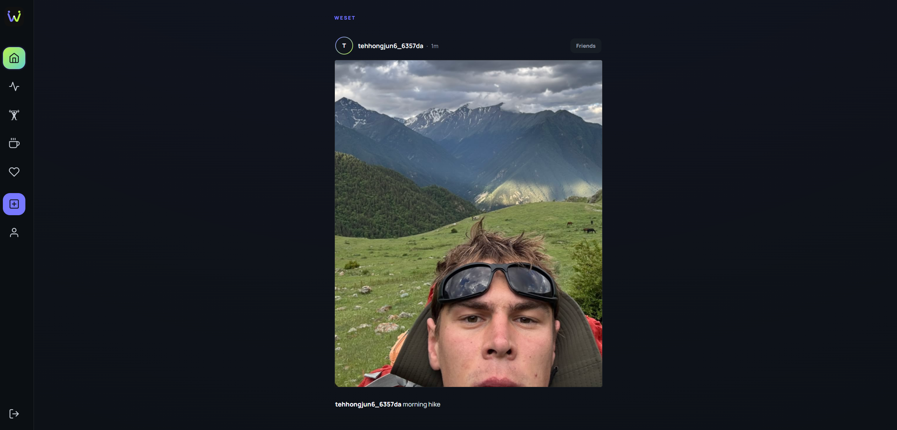

# WESET Frontend



WESET is a full-stack fitness and social platform where users can track workouts, discover exercises, explore food and nutrition information, share fitness posts, and connect with friends.

This repository contains the React frontend. The Express API is maintained in a separate backend repository.

## Live Application

- Frontend: [https://gym-tracker-frontend-vert.vercel.app](https://gym-tracker-frontend-vert.vercel.app)
- Backend API: [https://gym-backed-production.up.railway.app](https://gym-backed-production.up.railway.app)
- Backend repository: [https://github.com/tehhongjun6-alt/gym-backed](https://github.com/tehhongjun6-alt/gym-backed)

## Core Features

- Email and password signup and login
- Google OAuth through Supabase Authentication
- Protected routes for signed-in users
- Social feed with text and image posts
- Photo uploads through Supabase Storage
- Workout CRUD: create, read, update, and delete workout records
- Workout history grouped by date and body part
- Exercise library with search filters, movement images, and instructions
- Food calorie and nutrition search
- Healthy meal search with ingredients and cooking instructions
- User search, friend requests, request acceptance, and friends list
- Profile page with the user's posts, workouts, and friends
- Loading, error, and empty states across the main features
- Responsive desktop and mobile layouts

## Technology Stack

- React 19
- Vite
- React Router
- Supabase Authentication and Storage
- GSAP and ScrollTrigger
- React Icons
- Manrope font
- Vitest and React Testing Library
- Vercel

## Application Pages

| Route | Purpose |
| --- | --- |
| `/login` | Email login, Google login, and product introduction |
| `/signup` | Account registration |
| `/feed` | View posts and create fitness updates |
| `/workouts` | Record and manage workout history |
| `/exercises` | Search exercise suggestions and movement guides |
| `/food` | Search nutrition data and healthy meals |
| `/friends` | Find users, manage requests, and view friends |
| `/profile` | View personal activity, posts, workouts, and friends |

## Project Structure

```text
src/
|-- assets/            Images, logos, and muscle illustrations
|-- components/        Shared layout, header, drawer, modal, and route components
|-- pages/             Application pages and page-specific logic
|-- styles/
|   |-- components/    Shared component styles
|   `-- pages/         Page-specific styles
|-- tests/
|   |-- components/    Component tests
|   `-- pages/         Page and style tests
|-- api.js             Shared backend API request helper
|-- supabaseAuth.js    Supabase authentication client
|-- supabaseStorage.js Supabase Storage client
|-- App.jsx            Routes and authentication state
`-- main.jsx           React entry point
```

## Local Setup

### 1. Clone the repository

```bash
git clone https://github.com/tehhongjun6-alt/gym-tracker-frontend.git
cd gym-tracker-frontend
```

### 2. Install dependencies

```bash
npm install
```

### 3. Create the environment file

Create a `.env` file in the project root:

```env
VITE_API_URL=http://localhost:3000
VITE_SUPABASE_URL=your_supabase_project_url
VITE_SUPABASE_PUBLISHABLE_KEY=your_supabase_publishable_key
```

Only use the Supabase publishable key in the frontend. Database passwords, Supabase secret keys, and third-party API secret keys belong in the backend environment.

### 4. Start the development server

```bash
npm run dev
```

Vite normally serves the application at `http://localhost:5173`.

The backend must also be running when testing authenticated features, workouts, posts, friends, exercises, and food searches.

## Available Commands

```bash
npm run dev       # Start the Vite development server
npm run build     # Create a production build
npm run preview   # Preview the production build locally
npm run lint      # Run Oxlint
npm test          # Run Vitest in watch mode
npm test -- --run # Run the tests once
```

## How Authentication Works

1. The user signs up or logs in with email and password, or starts Google OAuth.
2. Supabase returns an authenticated session.
3. The access token is stored in the browser and passed to the Express API as a Bearer token.
4. Protected pages are unavailable when no token exists.
5. Logging out clears both the Supabase session and the saved access token.

## How Image Posts Work

1. The user selects an image in the Create Post modal.
2. The browser uploads the file to Supabase Storage.
3. The frontend sends the post content and image information to the Express API.
4. The saved post appears in the social feed.

## Deployment

The frontend is deployed on Vercel. Configure these variables for Production and Preview deployments:

```env
VITE_API_URL=https://gym-backed-production.up.railway.app
VITE_SUPABASE_URL=your_supabase_project_url
VITE_SUPABASE_PUBLISHABLE_KEY=your_supabase_publishable_key
```

The included `vercel.json` rewrites application routes to `index.html`, allowing React Router pages such as `/feed` and `/profile` to work when opened or refreshed directly.

## Current Verification Status

- Production build: passing
- Automated tests: 29 passing, 7 outdated UI assertions currently failing

The remaining test failures check interface text and controls that changed during the final redesign. They should be updated before reporting that the full automated test suite passes.

## Product Identity

**WESET**  
**Train. Share. Together.**
